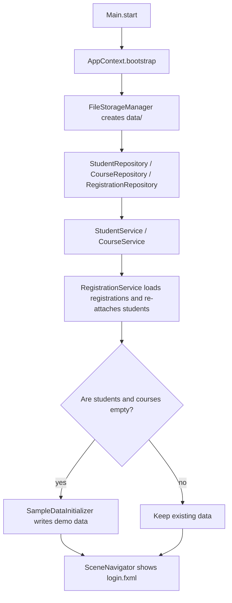
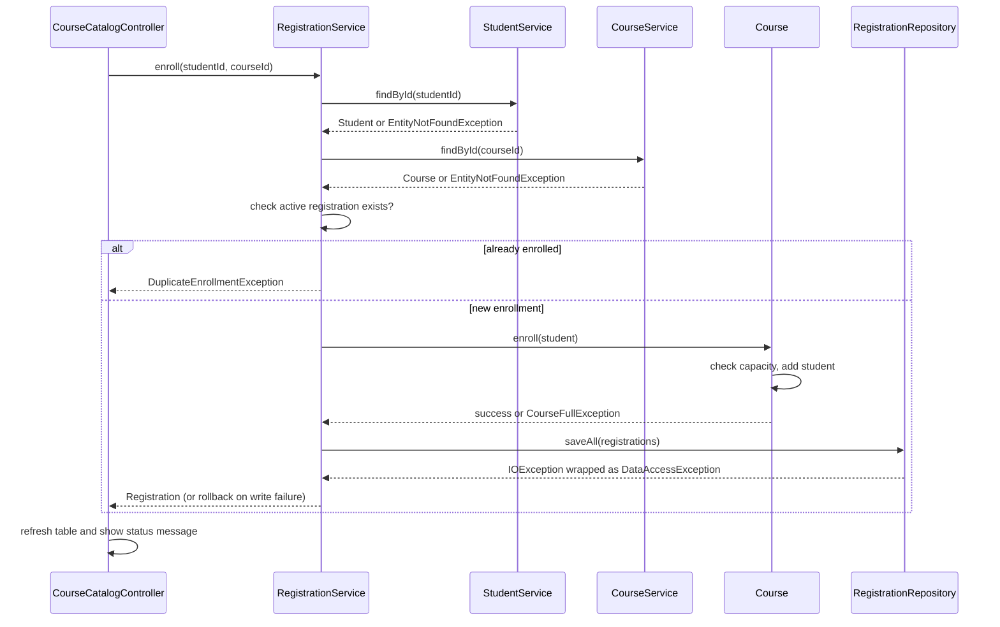

# Architecture

## 1. Architectural style

The application uses a small **layered architecture** with constructor-based
dependency injection. It is intentionally simpler than a layered enterprise design:

```
┌─────────────────────────────────────────────────────────────────────┐
│ Presentation         FXML layouts, CSS, controllers, SceneNavigator │
├─────────────────────────────────────────────────────────────────────┤
│ Application services StudentService, CourseService,                 │
│                      RegistrationService                            │
├─────────────────────────────────────────────────────────────────────┤
│ Domain model         Person / Student / Administrator, Course,      │
│                      Registration, Registrable, exceptions          │
├─────────────────────────────────────────────────────────────────────┤
│ Persistence          StudentRepository, CourseRepository,           │
│                      RegistrationRepository, FileStorageManager     │
├─────────────────────────────────────────────────────────────────────┤
│ Storage              CSV files in ./data                            │
└─────────────────────────────────────────────────────────────────────┘
```

`config/AppContext` is the composition root: it creates the storage manager, the
repositories, the services and holds the current session (signed-in person).

## 2. Package responsibilities

| Package | Responsibility | Key types |
| --- | --- | --- |
| `com.studentregistration` | JavaFX entry point | `Main` |
| `config` | Wiring, constants, demo data, session state | `AppContext`, `AppConfig`, `SampleDataInitializer` |
| `model` | Domain entities and rules that belong to a single object | `Person`, `Student`, `Administrator`, `Course`, `Registration`, `RegistrationStatus` |
| `interfaces` | Contracts | `Registrable` |
| `service` | Use cases and cross-entity business rules | `StudentService`, `CourseService`, `RegistrationService` |
| `repository` | Reading/writing CSV records | `StudentRepository`, `CourseRepository`, `RegistrationRepository`, `FileStorageManager` |
| `exception` | Business and persistence error types | `RegistrationException`, `ValidationException`, `CourseFullException`, `DuplicateEnrollmentException`, `EntityNotFoundException`, `DataAccessException` |
| `controller` | FXML event handlers and table binding | `LoginController`, `AdminDashboardController`, `StudentManagementController`, `CourseManagementController`, `StudentDashboardController`, `CourseCatalogController`, `MyCoursesController` |
| `util` | Reusable helpers without business meaning | `Validator`, `CsvUtils`, `AlertHelper`, `SceneNavigator` |
| `resources/fxml` | Seven screen layouts | `*.fxml` |
| `resources/css` | Single shared stylesheet | `styles.css` |
| `resources/images` | Bundled GUI image asset | `university-mark.png` |

## 3. Separation of concerns

| Concern | Where it lives | Example |
| --- | --- | --- |
| Widget layout | FXML | `student-management.fxml` |
| Visual styling | CSS | `styles.css` |
| Event wiring | Controllers | `@FXML private void handleAdd()` |
| Input validation | `Validator` + services | `Validator.requireEmail(...)` |
| Enrollment rules | `Course` + `RegistrationService` | capacity check, duplicate check |
| Cross-entity rules | `RegistrationService` | “cannot delete a course with active enrollments” |
| Persistence format | Repositories | CSV header and column order |
| File safety | `FileStorageManager` | temporary file + atomic move |

Controllers never create domain records directly from user input without a service
call, never write files and never decide whether an enrollment is legal.

## 4. Dependency direction

```
Main → AppContext → repositories → FileStorageManager
                 → services → domain model
SceneNavigator → controllers → services + AppContext
```

Dependencies point **downwards**. The domain model does not import JavaFX or the
repository package; services do not import JavaFX; only controllers know about
`Stage`, `TableView` and alerts.

Services receive concrete repositories through their constructors. This is a
deliberate simplification for a second-semester project; introducing repository
interfaces would add a layer without teaching anything the `Registrable` interface
does not already demonstrate (see `docs/decisions/0004`).

## 5. Data flow

### 5.1 Application start



### 5.2 Student enrollment



## 6. Class relationships

| Relationship | Implementation |
| --- | --- |
| Inheritance | `Student extends Person`, `Administrator extends Person` |
| Interface implementation | `Course implements Registrable` |
| Aggregation | `Course` holds `List<Student>`; students exist independently |
| Association by identifier | `Registration` references `studentId` and `courseId` |
| Composition (lifetime) | `RegistrationService` owns the in-memory registration list; `AppContext` owns the services |
| Dependency injection | Repositories passed to services, `AppContext` passed to controllers |
| Polymorphism | `Person.getRole()` / `getContactSummary()` overridden in subclasses |
| Overloading | `Student` constructors, `StudentService.addStudent(...)` overloads |
| No-argument constructors | Required by the brief; entities can be created empty and filled through setters |
| Package-private methods | `toCsvLine(...)` in the three repositories, testable from the same package only |
| GUI images | `ImageView` in each FXML header, resolved from `resources/images` |

## 7. Session and navigation

- `AppContext` stores the signed-in `Person` (`Student` or `Administrator`).
- `SceneNavigator` loads an FXML file, applies the shared stylesheet and swaps the
  scene of the single primary `Stage`.
- Controllers are created through a controller factory that injects the same
  `AppContext`, so no static singletons are needed.
- Logging out clears the current user and returns to the login screen.

## 8. Error handling strategy

1. **Input errors** — `Validator` throws `ValidationException` with a message written
   for end users.
2. **Business rule violations** — `Course` and `RegistrationService` throw
   `CourseFullException`, `DuplicateEnrollmentException`, `EntityNotFoundException`
   or `ValidationException`, all subclasses of `RegistrationException`.
3. **Persistence failures** — repositories catch `IOException` and rethrow
   `DataAccessException` with the original cause.
4. **GUI** — controllers catch `RegistrationException` and display its message in an
   inline status label; unexpected start-up failures show a dialog with the stack
   trace.

A failed enrollment write rolls the in-memory course back, so the screen never shows
an enrollment that was not saved.

## 9. Why this design suits the assessment

- Every required OOP concept appears at least once, in a small number of classes.
- Each screen maps to one controller, so the demonstration can follow the UI.
- Business rules are in plain Java classes with JUnit tests, which supports
  individual questions such as “show me where duplicate enrollment is prevented”.
- No generated code or hidden framework behaviour: students can explain every line.

## Test 
Yasmin Device