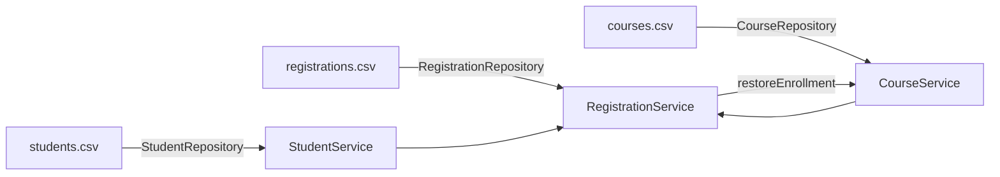

# Database and Persistence

## 1. Approach

The project does not use a database server. Data is stored in three UTF-8 CSV files
inside the `data/` directory:

```
data/
├── students.csv
├── courses.csv
└── registrations.csv
```

This satisfies the assignment's file-operation requirement and keeps the project
runnable on any machine with a JDK. All access goes through `java.nio.file`
(`Files`, `Path`), and every method that touches the disk declares or wraps
`IOException`.

## 2. Why CSV instead of a database

| Criterion | CSV (chosen) | Database server (rejected) |
| --- | --- | --- |
| Setup for markers/teammates | None | Needs install and credentials |
| Demonstrates `IOException` handling | Yes | Hides it behind JDBC |
| Suitable for a 4–5 student course project | Yes | Overkill |
| Concurrency | Single user only | Needed for multi-user |

The limitations are documented and acceptable: the application is a desktop
demonstration, not a production registration service.

## 3. File formats

### 3.1 `students.csv`

| Column | Type | Rule |
| --- | --- | --- |
| `id` | text | unique, upper-case, 3–20 characters of letters/digits/hyphens |
| `name` | text | non-blank |
| `email` | text | matches `name@domain.tld` |
| `phone` | text | 7–20 characters, digits and `+ - ( ) space` |
| `major` | text | non-blank |
| `level` | integer | 1–8 |

```csv
id,name,email,phone,major,level
STU-1001,Sara Al-Qahtani,sara.alqahtani@taibah.edu.sa,0501000001,Computer Science,2
```

### 3.2 `courses.csv`

| Column | Type | Rule |
| --- | --- | --- |
| `id` | text | unique, upper-case |
| `title` | text | non-blank |
| `creditHours` | integer | 1–6 |
| `capacity` | integer | 1–500 and never below current enrollment |
| `instructor` | text | non-blank |
| `schedule` | text | free text, defaults to `Not scheduled` |

```csv
id,title,creditHours,capacity,instructor,schedule
CS113,Programming II,3,30,Dr. Mona Al-Harbi,Sun/Tue 10:00-11:30
```

### 3.3 `registrations.csv`

| Column | Type | Rule |
| --- | --- | --- |
| `id` | text | `REG-XXXXXXXX` generated with `UUID` |
| `studentId` | text | references `students.csv` |
| `courseId` | text | references `courses.csv` |
| `registeredAt` | ISO-8601 date-time | e.g. `2026-11-24T10:15:30.123` |
| `status` | enum | `ACTIVE` or `DROPPED` |

```csv
id,studentId,courseId,registeredAt,status
REG-7F3A91CC,STU-1001,CS113,2026-11-24T10:15:30.123,ACTIVE
```

Dropping a registration updates `status` to `DROPPED` instead of deleting the row.
The history explains why an old record may reference a course that was later removed
(removal is blocked while the registration is active; historical rows are deleted
together with their student or course).

## 4. Enrollments: source of truth

`registrations.csv` is the **single source of truth** for enrollments:

- `courses.csv` never stores a list of student IDs;
- at start-up, `RegistrationService` reads active registrations and calls
  `Course.restoreEnrollment(student)` to rebuild the in-memory list;
- every enrollment action writes the registration file immediately.

This avoids two copies of the same fact becoming inconsistent.



## 5. Write safety and error handling

`FileStorageManager.writeLines(...)` writes to a temporary file in the same
directory and moves it over the target with `ATOMIC_MOVE` (falling back to
`REPLACE_EXISTING` when the file system does not support atomic moves). A crash
during a save therefore cannot leave a half-written CSV file.

Repositories translate `IOException` into `DataAccessException`:

```java
try {
    storage.writeLines(FILE_NAME, lines);
} catch (IOException ex) {
    throw new DataAccessException("Could not save " + FILE_NAME + ": " + ex.getMessage(), ex);
}
```

`RegistrationService` also rolls back in-memory changes when a write fails, so the
GUI never displays an enrollment that was not persisted.

## 6. Data directory

- Location: `./data` relative to the working directory (project root when started
  with Maven).
- Created automatically by `FileStorageManager` if missing.
- Ignored by Git (`data/*` except `.gitkeep`) so every teammate has an independent
  local dataset.

### Demo data

On the first start, when both students and courses are empty,
`config/SampleDataInitializer` creates:

| Type | Values |
| --- | --- |
| Students | `STU-1001` Sara Al-Qahtani, `STU-1002` Omar Al-Zahrani, `STU-1003` Layla Al-Mutairi |
| Courses | CS113 Programming II, CS210 Object-Oriented Programming, CS201 Data Structures, IS220 Database Fundamentals |
| Enrollments | Sara → CS113, CS210; Omar → CS113, CS201 |

Delete the three CSV files to reseed on the next start.

## 7. Reset and inspection

```bash
# Inspect the data
column -s, -t data/students.csv
column -s, -t data/courses.csv
column -s, -t data/registrations.csv

# Reset to demo data (application must be closed)
rm data/*.csv
mvn javafx:run
```

## 8. Known limitations

- Single-user desktop application; no file locking for concurrent writers.
- No transactions across the three files: a failure between two writes could leave
  partial changes. The unavoidable window is documented for transparency.
- CSV fields are quoted by `CsvUtils` when they contain commas, quotes or line
  breaks; the format is not intended for binary data.
- No indexing: files are read fully into memory at start-up, which is fine for a
  course project.
