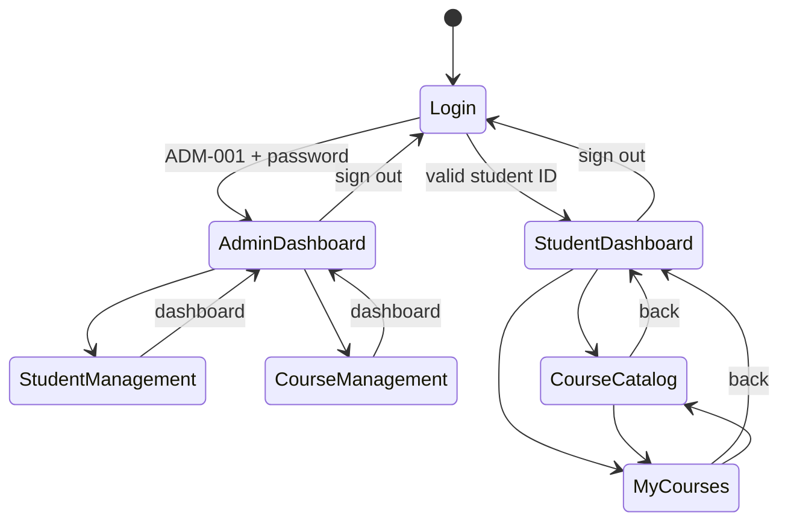

# GUI Design

## 1. Screens

The application uses **seven FXML screens** in one resizable window. Layout,
controller and styling are separated: FXML declares the widget tree, controllers
handle events, and `styles.css` defines the visual language.

| # | Screen | FXML | Controller | Role | Purpose |
| --- | --- | --- | --- | --- | --- |
| 1 | Login | `login.fxml` | `LoginController` | All | Choose role, enter identifier (and administrator password) |
| 2 | Administrator dashboard | `admin-dashboard.fxml` | `AdminDashboardController` | Administrator | Statistics and course overview |
| 3 | Student management | `student-management.fxml` | `StudentManagementController` | Administrator | Student CRUD and search |
| 4 | Course management | `course-management.fxml` | `CourseManagementController` | Administrator | Course CRUD, enrollment inspection and drop |
| 5 | Student dashboard | `student-dashboard.fxml` | `StudentDashboardController` | Student | Personal information and current courses |
| 6 | Course catalogue | `course-catalog.fxml` | `CourseCatalogController` | Student | Browse, search and enroll |
| 7 | My registered courses | `my-courses.fxml` | `MyCoursesController` | Student | Review and drop registrations |

## 2. Navigation map



## 3. Layout conventions

| Element | Rule |
| --- | --- |
| Window | 1120 × 740 initial size, minimum 980 × 660, centred on first show |
| Header | White bar with the round university mark, screen title, subtitle, user chip or sign-out button |
| Page padding | 22–28 px, 18 px gap between cards |
| Cards | White surface, 1 px border `#e4eae8`, 12 px radius, 16 px padding |
| Tables | Striped rows, muted header, constrained column resizing, contextual placeholder |
| Forms | Right-hand 300–340 px card; labels above fields; primary action first |
| Buttons | Primary = filled green, secondary = pale green, ghost = outlined, danger = pale red |
| Feedback | Inline status label under the form; modal alerts only for destructive confirmation and fatal errors |

## 4. Visual language

- **Primary colour** `#0b6b57` — Taibah-inspired deep green.
- **Accent** `#14a47c` — used in the login gradient only.
- **Background** `#f4f6f8` → cards `#ffffff`.
- **Text** `#1f2d28` primary, `#6b7c77` secondary.
- **Error** `#b3261e`; **success** `#0b6b57`.
- Font: system sans-serif (`Noto Sans` / `DejaVu Sans` fallback), 12.5–13 px body,
  28 px statistic values.
- The only image asset is `src/main/resources/images/university-mark.png`, shown at
  64 px on the login card and 34 px in every screen header. It is bundled with the
  application, so the interface works fully offline.

### 4.1 Images in FXML

JavaFX cannot coerce an image path string into an `Image` directly, so every screen
declares the asset with the nested form:

```xml
<ImageView fitHeight="34" fitWidth="34" preserveRatio="true">
    <image>
        <Image url="@../images/university-mark.png"/>
    </image>
</ImageView>
```

`@../images/...` is resolved relative to the FXML file, which lives in `fxml/`.
This satisfies the brief's requirement to use **images** in the GUI.

## 5. Screen sketches

### 5.1 Login

```
┌──────────────────────────────────────────────┐
│  green gradient background                    │
│        ┌────────────────────────────┐        │
│        │ (TU)  TAIBAH UNIVERSITY    │        │
│        │ Student Course Registration│        │
│        │ CS113 · 2026/2027          │        │
│        │ ─────────────────────────  │        │
│        │ Sign in as   [Student  ▾]  │        │
│        │ ID           [STU-1001   ] │        │
│        │ (password only for admin)  │        │
│        │ [ Sign in          ] [Exit]│        │
│        │ demo account hint          │        │
│        └────────────────────────────┘        │
└──────────────────────────────────────────────┘
```

### 5.2 Administrator dashboard

```
┌──────────────────────────────────────────────────────────────┐
│ Administrator dashboard            System Administrator  ⏻   │
├──────────────────────────────────────────────────────────────┤
│ [STUDENTS 3] [COURSES 4] [ACTIVE ENROLLMENTS 4] [SEATS 16%] │
│ [Manage students] [Manage courses]                [Refresh]  │
│ ┌──────────────────────────────────────────────────────────┐ │
│ │ Course overview                                          │ │
│ │ ID     Title                    Instructor     Enrolled   │ │
│ │ CS113  Programming II           Dr. Mona ...   2 / 30     │ │
│ └──────────────────────────────────────────────────────────┘ │
└──────────────────────────────────────────────────────────────┘
```

### 5.3 Student management

- Search bar with **Search** and **Clear** on the left.
- Table of students; selecting a row fills the form and disables **Add**.
- Right form: ID, name, email, phone, major, level; Add/Update/Delete/Clear.
- Status label communicates success or the exact validation message.

### 5.4 Course management

- Course table plus a second table listing enrolled students of the selected course.
- **Drop selected student** requires a confirmation dialog.
- Right form mirrors the course attributes; capacity cannot be set below the number
  of enrolled students.

### 5.5 Student dashboard

- Personal-information card, two statistic cards (enrolled courses, credit hours),
  and a table of current registrations.
- **Browse courses**, **My courses**, **Refresh**, **Sign out**.

### 5.6 Course catalogue

- Search bar, course table with seats and status (Open/Full), enroll button that is
  disabled for full courses or empty selection.

### 5.7 My registered courses

- Table of active courses, total credit hours, **Drop selected course** with
  confirmation, link back to the catalogue.

## 6. Interaction and validation feedback

1. Field validation runs before any service call and produces a specific message, for
   example “Email is required.” or “Level must be between 1 and 8.”
2. Business errors (duplicate ID, full course, duplicate enrollment, missing record)
   are shown in the same inline status label.
3. Successful operations confirm what happened, for example
   “Student STU-1004 added.”
4. Delete and drop actions require explicit confirmation.
5. Tables refresh after every successful change; enrollment counts and seat values
   are recomputed from the services.
6. The primary button on the login form is the default button, so <kbd>Enter</kbd>
   submits the form.

## 7. Accessibility and usability notes

- Colour contrast of primary text and buttons exceeds the usual 4.5:1 guideline.
- Focus is visible on text fields (green border) and buttons keep native focus
  outlines.
- All actions are reachable with the keyboard through normal tab order; tables
  support arrow-key navigation.
- Empty tables show an explanatory placeholder instead of a blank area.
- Window resizing is supported; tables and the course list expand, forms keep a
  fixed usable width.
