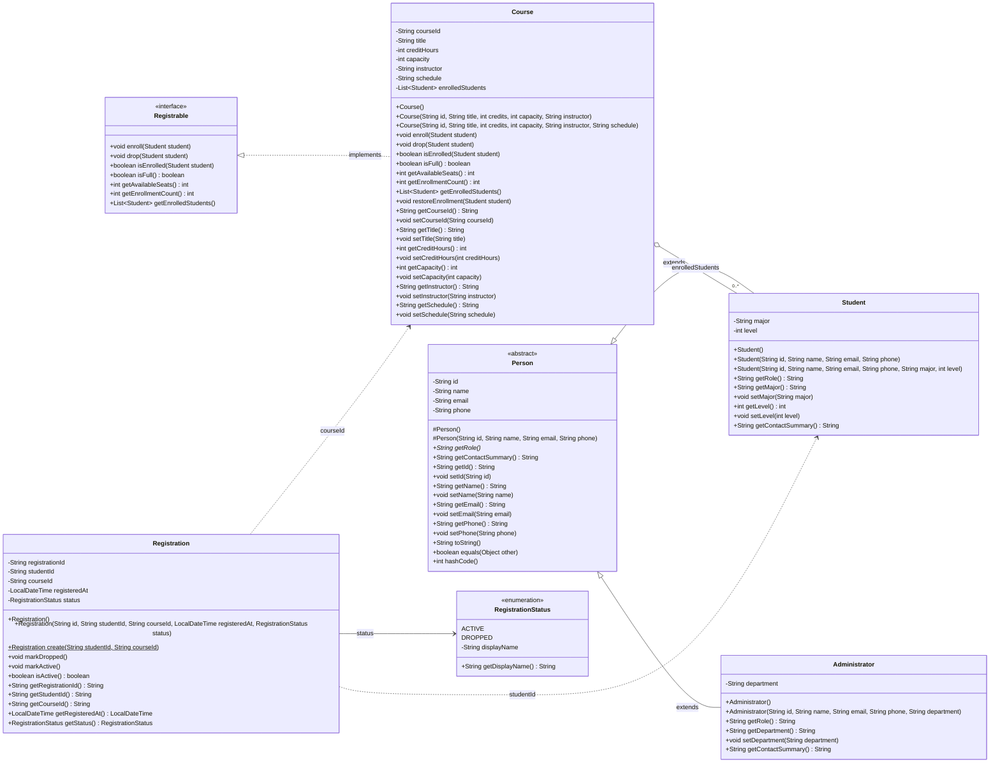
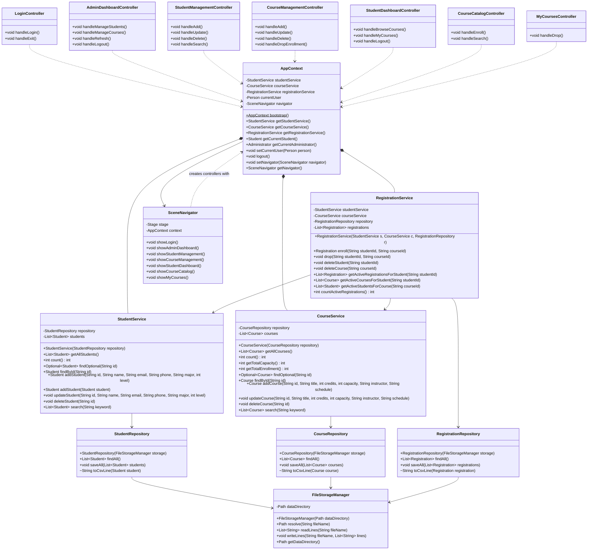

# UML Class Diagram

The diagrams below are written in [Mermaid](https://mermaid.js.org/) and mirror the
actual implementation in `src/main/java/com/studentregistration`. Multiplicities and
relationships use Mermaid class-diagram syntax.

## 1. Domain model

**Legend**

- `<|--` inheritance; `..|>` interface realisation; `o--` aggregation.
- `Person` is abstract and cannot be instantiated.
- `Course` **aggregates** students: the same `Student` object is shown in several
  courses and is not destroyed with the course.
- `Registration` refers to students and courses by identifier, which is exactly how
  the records are stored on disk.

## 2. Services, repositories and GUI

## 3. Design notes linked to the diagram

| Concept | Where to point during the assessment |
| --- | --- |
| Encapsulation | Private fields in `Person`, `Course`, `Registration`; access through getters/setters |
| Abstraction | Abstract `Person`; `Registrable` interface |
| Inheritance | `Student` and `Administrator` extend `Person` |
| Polymorphism | `context.getCurrentUser()` can be either subclass; `getRole()` dispatches dynamically |
| Method overriding | `getRole()` and `getContactSummary()` in both subclasses; `enroll()` in `Course` |
| Method overloading | Two `Student` constructors; two `addStudent(...)` methods |
| No-argument constructors | `Person()`, `Student()`, `Administrator()`, `Course()`, `Registration()` — required by the brief |
| Parameterized constructors | Every entity, service, repository and `AppContext` is constructed with arguments |
| Package-private methods | `toCsvLine(...)` in the three repositories (visible to same-package tests only) |
| Aggregation | `Course` keeps `List<Student>` |
| Composition | `AppContext` owns services; `RegistrationService` owns registration records |
| Exception hierarchy | `RegistrationException` → validation, full, duplicate, not-found |
| File I/O | `FileStorageManager` with `IOException` and `DataAccessException` |

> The diagram is intentionally limited to public API that matters for the report.
> Getters/setters of some classes are omitted to keep it readable; they exist in the
> source and are listed in `docs/REQUIREMENTS.md`.
